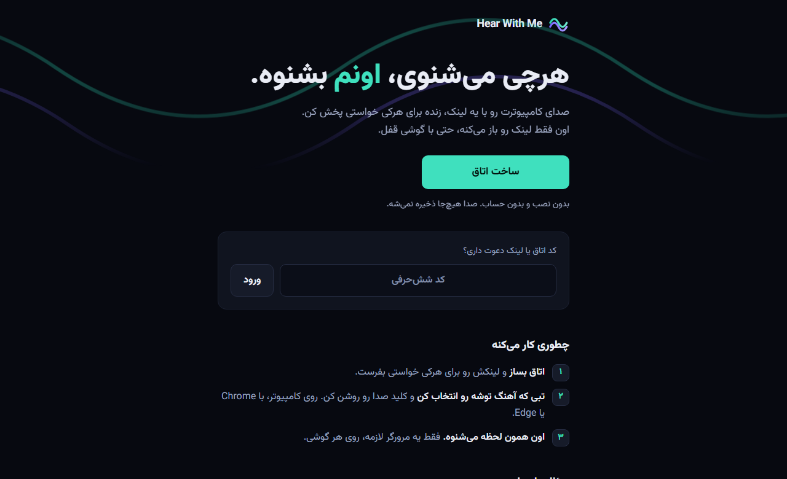
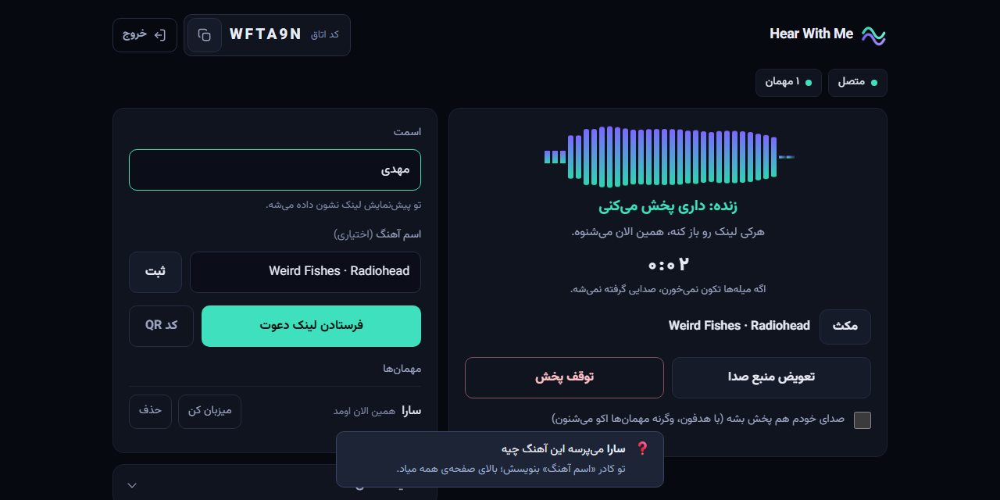
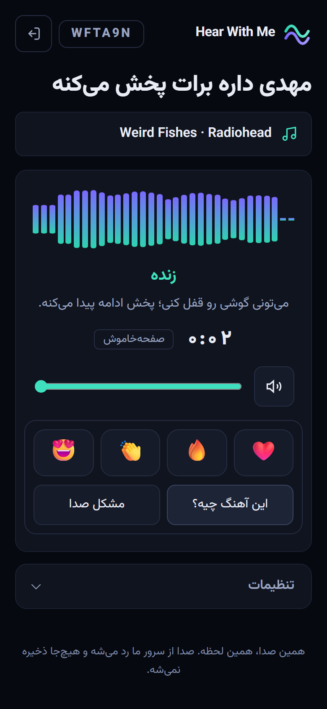

<div align="center">
  
  <h1>Hear With Me</h1>
  <p><strong>هرچی می‌شنوی، اونم بشنوه.</strong> همین صدا، همین لحظه.</p>
  <p>
    <a href="README.md">English</a> ·
     ·
     ·
    
  </p>
</div>



## این چیه

داری روی کامپیوترت یه چیزی گوش می‌دی: یه تب اسپاتیفای، یوتیوب، یه فایل یا یه اپ.
یه لینک می‌فرستی. اون طرف بازش می‌کنه، معمولاً با گوشی، و همون لحظه همون چیزی رو
می‌شنوه که تو می‌شنوی؛ حتی وقتی گوشیش قفله و تو جیبشه.

این «پخش‌کننده‌ی هماهنگ» یا «پلی‌لیست مشترک» نیست. کسی آهنگ انتخاب نمی‌کنه. صدای
واقعیِ خروجی میزبان تو مرورگر گرفته می‌شه و فرستاده می‌شه.

هیچ‌چیز ذخیره نمی‌شه: نه حسابی هست، نه ضبطی، و با بسته شدن اتاق هیچ اثری ازش
نمی‌مونه.

<table>
<tr>
<td width="62%"></td>
<td></td>
</tr>
<tr>
<td align="center"><sub>میزبان، روی کامپیوتر</sub></td>
<td align="center"><sub>مهمان، روی گوشی</sub></td>
</tr>
</table>

## دو مسیر برای یک صدا

| | هم‌زمان (مستقیم) | صفحه‌خاموش |
|---|---|---|
| چطور | WebRTC، مرورگر به مرورگر | AAC از راه سرور، تو یه `<audio>` معمولی |
| تأخیر | کمتر از یک‌دهم ثانیه | حدود دو تا چهار ثانیه |
| گوشی قفل | قطع می‌شه (سیستم‌عامل اینو «تماس» می‌بینه) | ادامه پیدا می‌کنه، با کنترل روی صفحه‌ی قفل |
| شبکه‌های بدون UDP (رایج تو ایران) | ممکنه هیچ‌وقت وصل نشه | هرجا صفحه باز بشه، کار می‌کنه |
| صدا از سرور رد می‌شه | نه | بله، فقط تو حافظه و هیچ‌جا ذخیره نمی‌شه |

گوشی‌ها با «صفحه‌خاموش» شروع می‌کنن و کامپیوترها با «هم‌زمان». مهمان هر وقت خواست
می‌تونه از تنظیمات صفحه عوضش کنه. اگه اتصال مستقیم تو شش ثانیه برقرار نشه، خودکار
به صفحه‌خاموش می‌ره و همینو می‌گه. میزبان می‌تونه اتاق رو تو تنظیمات روی «فقط
مستقیم» بذاره.

صفحه‌خاموش AAC است، چون هر گوشی‌ای، آیفون هم، جریان AAC رو پخش می‌کنه و شنونده از
هر فریمی می‌تونه وارد بشه. مرورگر میزبان با WebCodecs انکودش می‌کنه (Chrome و Edge
روی کامپیوتر این کار رو می‌کنن)، اونم فقط وقتی کسی این‌طوری گوش می‌ده. جایی که AAC
نباشه، WebM/Opus جایگزینه که آیفون پخشش نمی‌کنه.

## وب و اندروید

یه کلاینت، همه‌جا. پوشه‌ی `app/` همون رو برای اندروید بسته‌بندی می‌کنه (راهنما:
[app/README.md](app/README.md)) و GitHub Actions با هر push یه APK می‌سازه. اپ اندروید
می‌تونه صدای اپ‌های دیگه رو پخش کنه، کاری که هیچ مرورگر گوشی‌ای اجازه نمی‌ده
([توضیح](docs/android-host.md)).

اپ آیفون نداریم. آیفون توی مرورگرش گوش می‌ده و فقط می‌تونه یه فایل از خود گوشی رو
پخش کنه.

## کی چی کار می‌تونه بکنه

| | |
|---|---|
| میزبان، پخش هرچی که پخش می‌شه | کامپیوتر با **Chrome یا Edge**. هیچ مرورگر گوشی‌ای صدای اپ یا تب دیگه رو نمی‌ده. |
| میزبان، از گوشی | اپ اندروید: هرچی رو گوشی پخش بشه. مرورگر هر گوشی‌ای: یه فایل صوتی. |
| مهمان | هر دستگاهی که مرورگر داشته باشه، آیفون هم. اپ لازم نیست. |

## اجرا

```bash
node server.js
```

بعد `http://localhost:3000` رو باز کن. چیزی برای نصب نیست: نه وابستگی npm در زمان
اجرا، نه build step.

برای تست روی دو دستگاه واقعی، سرور باید روی **HTTPS** باشه. `getDisplayMedia`،
WebCodecs و `RTCPeerConnection` فقط تو secure context کار می‌کنن و `localhost` تنها
استثناست:

```bash
ssh -R 80:localhost:3000 nokey@localhost.run
```

> با Cloudflare quick tunnel (`trycloudflare.com`) کار نمی‌کنه. کل پاسخ رو بافر می‌کنه،
> سیگنالینگ این سرور Server-Sent Events است و صفحه روی «در حال اتصال» می‌مونه.

## داخل اتاق چه کارهایی می‌شه کرد

**میزبان**

- قبل از باز شدن پنجره‌ی Chrome یه یادآوری کوتاه می‌بینه درباره‌ی کلیدی که همه‌چیز
  بهش بستگی داره («Also share tab audio»). بعدش بررسی سیگنال: اتاق فقط وقتی «زنده»
  اعلام می‌شه که واقعاً صدایی شنیده بشه.
- وسط پخش منبع رو عوض می‌کنه (`replaceTrack`) و هیچ مهمانی قطع نمی‌شه.
- به‌جاش یه فایل از همین دستگاه پخش می‌کنه، یا میکروفون خودش رو هم قاطی می‌کنه.
- کیفیت صدا، قفل اتاق، حذف مهمان، سپردن میزبانی و «فقط مستقیم».
- اسمش تو پیش‌نمایش لینک میاد: «مهدی داره زنده پخش می‌کنه».
- لینک رو می‌فرسته، یا کد QR نشون می‌ده تا اسکن کنن.

**مهمان**

- صفحه با اسم کسی که پخش می‌کنه شروع می‌شه. یه ضربه برای گوش دادن.
- واکنش نشون می‌ده: قلب، آتیش، تشویق، یا «این آهنگ چیه؟»، و مشکل صدا رو گزارش
  می‌ده. هرچی میزبان باید درستش کنه رو صفحه می‌مونه و می‌گه چی کار کنه.
- وقتی پخش تموم می‌شه: چقدر با هم گوش دادید، و لینکی برای فرستادن به کامپیوتر
  خودش.

## چطور کار می‌کنه

```
منبع صدا (هرچی)                   یا یه فایل روی دستگاه میزبان
        |
capture                    <- مرورگر میزبان: getDisplayMedia، یا Web Audio برای فایل
        |
   +----+-----------------------------+
WebRTC (مستقیم)              انکودر AAC (WebCodecs)، فقط وقتی لازمه
   |                                  |
   |                          سرور اتاق: برش و پخش، فقط در حافظه
   |                                  |
مهمان: srcObject              مهمان: <audio src>، با صفحه‌ی قفل هم زنده
```

سرور اتاق می‌سازه، میزبان رو تعیین می‌کنه، سیگنالینگ رو جابه‌جا می‌کنه، و فقط برای
شنونده‌های صفحه‌خاموش صدای انکودشده‌ی میزبان رو رد می‌کنه. اعضا رو با
**Server-Sent Events** یا **WebSocket** پیدا می‌کنه: صفحه یه تگ `transport` داره که
سرور پرش می‌کنه، و کلاینت هر دو رو بلده.

```
server.js          سیم‌کشی
lib/               config, room, rooms, routes, sse, http, rate-limit, metrics
public/app.js      نقطه‌ی ورود کلاینت: نقش‌ها و مسیر رویدادها، بدون منطق
public/js/         host-session, guest-session, relay-encoder, relay-player, platform,
                   dom, api, roster, notices, audio-meter, end-card, ...
public/shared/     reactions, room-code, relay-framing, preview, metrics:
                   هرکدوم یک تعریف، مشترک بین سرور و صفحه
public/sw.js       پوسته‌ی اپ برای نصب؛ هرگز به /api/ دست نمی‌زنه
```

`public/js/platform.js` تنها جاییه که می‌دونه دستگاه چه کارهایی بلده. پوسته‌ی اپ همین
درز رو عوض می‌کنه تا گوشی بتونه صدای اپ‌های دیگه رو به‌صورت بومی بگیره.

## پیکربندی

| متغیر | پیش‌فرض | کارش |
|---|---|---|
| `PORT` | `3000` | |
| `STUN_URL` | STUN عمومی گوگل | چندتا با کاما |
| `TURN_URL`, `TURN_USERNAME`, `TURN_PASSWORD` | ندارد | به چیزی که کلاینت می‌گیره اضافه می‌شه |
| `MAX_ROOMS` | `500` | اتاق‌های هم‌زمان |
| `ROOMS_PER_IP` | `12` | ساخت اتاق برای هر IP در ۱۰ دقیقه |
| `API_REQUESTS_PER_MINUTE` | `900` | همه‌ی درخواست‌های API، برای هر IP |
| `ROOM_LOOKUPS_PER_MINUTE` | `60` | پیدا کردن اتاق با کد، برای هر IP |
| `DISCONNECT_GRACE_MS` | `10000` | اتصال قطع‌شده‌ی مهمان تا کی جاش رو نگه می‌داره |
| `HOST_DISCONNECT_GRACE_MS` | `1800000` | همین برای میزبان (۳۰ دقیقه) |
| `ROOM_TTL_MS` | `21600000` | اتاق خالی بعد از این پاک می‌شه (۶ ساعت) |
| `RELAY_BACKLOG_MS` | `1500` | شنونده‌ی صفحه‌خاموش با چقدر صدا شروع می‌کنه |
| `STATS_TOKEN` | ندارد | اجازه می‌ده `GET /api/stats?token=...` شمارنده‌ها رو بخونه |

**شمارنده‌ها.** صفحه چند رویداد مشخص رو گزارش می‌ده: یه گوش دادن شروع شد و از کدوم
مسیر، یه اتصال مستقیم شکست خورد و ICE تا اون لحظه چی پیدا کرده بود، یه پخش ساکت
بود. سرور برای هر روز، رویداد و مقدار فقط یک عدد نگه می‌داره. نه شناسه، نه اسم، نه
کد اتاق، نه آدرس. هرچی بیرون از فهرست مجاز `public/shared/metrics.js` باشه دور
ریخته می‌شه.

## تست‌ها

```bash
npm test                                              # اتاق، QR، برش رله، پیش‌نمایش، محدودیت‌ها
npm install --no-save playwright && npx playwright install chromium
npm run test:e2e                                      # مرورگر واقعی، هر دو مسیر
node tools/make-screenshots.mjs                       # عکس‌های docs/ رو دوباره می‌سازه
```

`test-e2e.js` یه میزبان و دو مهمان واقعی رو روی WebRTC می‌سنجه. `test-relay.js` بقیه
رو با مرورگر واقعی تست می‌کنه: رسیدن صدای صفحه‌خاموش به‌صورت AAC، برگشت خودکار وقتی
اتصال مستقیم برقرار نمی‌شه، اولین ضربه‌ی گوشی، «فقط مستقیم»، میکروفون، کارت پایان،
و میزبانی از گوشی با یه فایل. با `BASE=...` روی یه دیپلوی دیگه هم اجرا می‌شه.

## محدودیت‌هایی که خوبه بدونی

- **این‌که گوشی قفل‌شده پخش رو ادامه می‌ده، فقط روی گوشی واقعی ثابت می‌شه.** مسیر
  صفحه‌خاموش مثل رادیوی اینترنتی ساخته شده که گوشی‌ها تو پس‌زمینه پخشش می‌کنن.
  مرورگر کامپیوتر نمی‌تونه اینو نشون بده.
- **مرورگر گوشی نمی‌تونه صدای اپ دیگه رو بفرسته.** اپ اندروید می‌تونه.
- **کد اتاق تنها محافظه.** قفل و حذف، کنترل‌های اجتماعی‌ان، نه امنیت.
- **هیچ‌چیز ذخیره نمی‌شه.** ری‌استارت سرور همه‌ی اتاق‌ها رو پاک می‌کنه.
