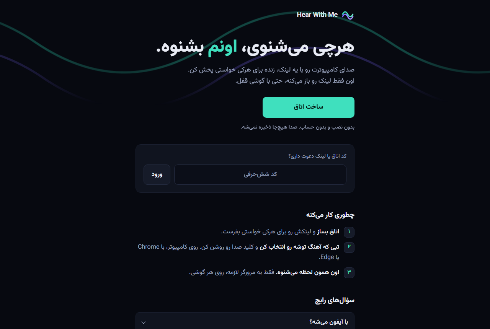
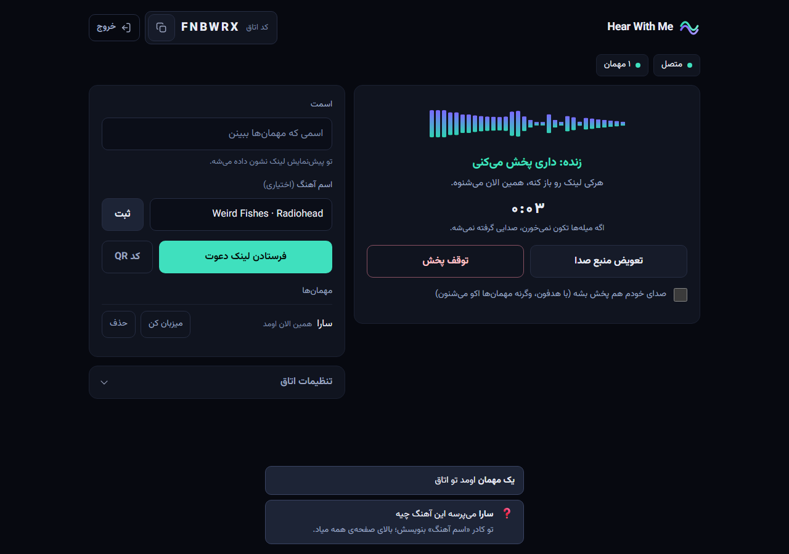
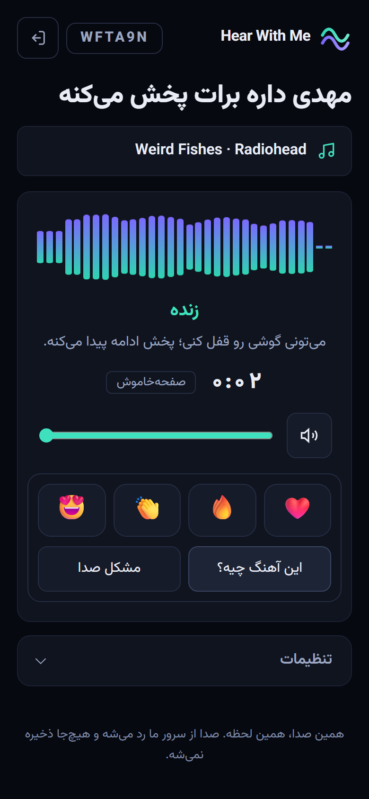
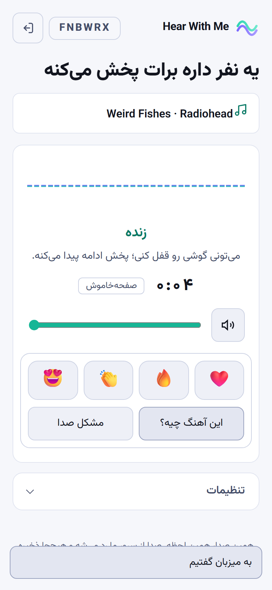

<div align="center">
  
  <h1>Hear With Me</h1>
  <p><strong>Whatever you hear, they hear too. Live, from one link.</strong></p>
  <p>
    <a href="README.fa.md">فارسی</a> ·
     ·
     ·
    
  </p>
</div>



## What it is

You are listening to something on your computer: a Spotify tab, YouTube, a
local file, a native app. You send one link. The other person opens it on their
phone and hears the same sound at the same moment, even with the phone locked
in a pocket.

It is not a synced player or a shared playlist. Nobody picks a track. The
host's real audio output is captured in the browser and sent on.

Nothing is stored. There are no accounts and no recordings, and a room leaves
nothing behind when it closes.

<table>
<tr>
<td width="62%"></td>
<td></td>
</tr>
<tr>
<td align="center"><sub>Host, on a computer</sub></td>
<td align="center"><sub>Guest, on a phone</sub></td>
</tr>
</table>

The pages follow the system's light or dark setting. Dark is the default look.



## Two paths for one sound

| | Direct | Screen-off |
|---|---|---|
| How | WebRTC, browser to browser | AAC through the server, in a plain `<audio>` element |
| Delay | under a tenth of a second | about two to four seconds |
| Locked phone | stops (the OS treats it as a call) | keeps playing, with lock-screen controls |
| Networks without UDP (common in Iran) | may never connect | works wherever the page loads |
| Audio passes through the server | no | yes, in memory only, never stored |

Phones start on screen-off and computers on direct. A guest can switch in the
page's settings at any time. A direct connection that is not up within six
seconds falls back to screen-off by itself and says so. The host can keep a
room direct-only from the room settings.

Screen-off is AAC because every phone browser plays an AAC stream, iPhones
included, and a listener can start at any frame. The host's browser encodes it with
WebCodecs (desktop Chrome and Edge can), only while someone listens this way.
Where AAC is not available it falls back to WebM/Opus, which iPhones cannot
play.

## Web and Android

One client runs everywhere. `app/` wraps it as an Android app (see
[app/README.md](app/README.md)), and GitHub Actions builds an APK on every
push. The Android app can host what other apps play, which no phone browser
allows ([how](docs/android-host.md)).

There is no iPhone app. An iPhone listens in its browser, and can host only a
file from the phone.

## Who can do what

| | |
|---|---|
| Host, sharing what is playing | Desktop **Chrome or Edge**. No phone browser hands out another app's or tab's sound. |
| Host, from a phone | The Android app: whatever plays on the phone. Any phone's browser: an audio file. |
| Guest | Any device with a browser, iPhone included. No app needed. |

## Run it

```bash
node server.js
```

Open `http://localhost:3000`. There is nothing to install: no runtime npm
dependencies and no build step.

To try it on two real devices, serve it over **HTTPS**. `getDisplayMedia`,
WebCodecs and `RTCPeerConnection` only work in a secure context, and
`localhost` is the one exception:

```bash
ssh -R 80:localhost:3000 nokey@localhost.run
```

> Cloudflare quick tunnels (`trycloudflare.com`) do not work. They buffer the
> whole response, this server's signaling is Server-Sent Events, and the room
> hangs on "connecting".

## What a room can do

**Host**

- A short reminder before Chrome's picker opens about the one switch that
  decides whether anyone hears anything ("Also share tab audio"), then a signal
  check. The room is called live only once sound is actually heard.
- Change the source mid-session without dropping anyone (`replaceTrack`).
- Play a file from the device instead, or mix their own microphone in.
- Set the sound quality, lock the room, remove a guest, hand hosting over, keep
  the room direct-only.
- Their name goes into the link preview: "Mehdi is playing live".
- Share the link, or show a QR code to scan.

**Guest**

- The page opens on who is playing. One tap to listen.
- React with a heart, fire, applause or "what is this song?", or report a sound
  problem. Anything the host has to fix stays on screen and says what to do.
- When the share ends: how long they listened, and a link to send to their own
  computer.

## How it works

```
Audio source (anything)           or a file on the host's device
        |
Capture                     <- host's browser: getDisplayMedia, or Web Audio for a file
        |
   +----+----------------------------+
WebRTC (direct)              AAC encoder (WebCodecs), only on demand
   |                                 |
   |                         Room server: framing + fan-out, in memory
   |                                 |
Guest: srcObject             Guest: <audio src>, survives a locked screen
```

The server creates rooms, decides who the host is, relays signaling, and, for
screen-off listeners only, passes the host's encoded audio on. It reaches
members over **Server-Sent Events** or a **WebSocket**: the page carries a
`transport` meta tag that the server fills in, and the client speaks both.

```
server.js          wiring
lib/               config, room, rooms, routes, sse, http, rate-limit, metrics
public/app.js      client entry: roles and event routing, no logic
public/js/         host-session, guest-session, relay-encoder, relay-player, platform,
                   dom, api, roster, notices, audio-meter, end-card, ...
public/shared/     reactions, room-code, relay-framing, preview, metrics:
                   one definition each, used by the server and the page
public/sw.js       the app shell, for installing; never touches /api/
```

`public/js/platform.js` is the one place that knows what the device can do. The
app shell replaces that seam so a phone can capture other apps' sound natively.

## Configuration

| Variable | Default | What it does |
|---|---|---|
| `PORT` | `3000` | |
| `STUN_URL` | Google's public STUN | Comma-separated for several |
| `TURN_URL`, `TURN_USERNAME`, `TURN_PASSWORD` | none | Added to what clients receive |
| `MAX_ROOMS` | `500` | Concurrent rooms |
| `ROOMS_PER_IP` | `12` | Room creations per IP per 10 minutes |
| `API_REQUESTS_PER_MINUTE` | `900` | Every API call, per IP |
| `ROOM_LOOKUPS_PER_MINUTE` | `60` | Looking a room up by code, per IP |
| `DISCONNECT_GRACE_MS` | `10000` | How long a guest's dropped connection keeps its place |
| `HOST_DISCONNECT_GRACE_MS` | `1800000` | The same for a host (30 minutes) |
| `ROOM_TTL_MS` | `21600000` | An empty room is swept after this (6 hours) |
| `RELAY_BACKLOG_MS` | `1500` | How much audio a screen-off listener starts with |
| `STATS_TOKEN` | none | Lets `GET /api/stats?token=...` read the counters |

**Counters.** The page reports a few named events: a listen started and on
which path, a direct connection that failed and what ICE had found, a share that
was silent. The server keeps one number per day, event and value. No ids, names,
codes or addresses; anything outside the allowlist in `public/shared/metrics.js`
is dropped.

## Tests

```bash
npm test                                              # rooms, QR, relay framing, previews, limits
npm install --no-save playwright && npx playwright install chromium
npm run test:e2e                                      # real browsers, both paths
node tools/make-screenshots.mjs                       # redraws the images in docs/
```

`test-e2e.js` drives a real host and two guests over WebRTC. `test-relay.js`
covers the rest in real browsers: screen-off audio arriving as AAC, the
fallback when a direct connection never comes up, a phone's first tap, the
host's direct-only switch, the microphone, the end card, and a phone hosting
from a file. Point it at another deployment with `BASE=...`.

## Limits worth knowing

- **A locked phone that keeps playing is only proven on a real phone.** The
  screen-off path is built the way internet radio is, which phones do play in
  the background. Desktop browsers cannot show it.
- **A phone browser cannot share another app's sound.** The Android app can.
- **The room code is the only protection.** Locking and removing are social
  controls, not security.
- **Nothing is stored.** Restarting the server clears every room.
