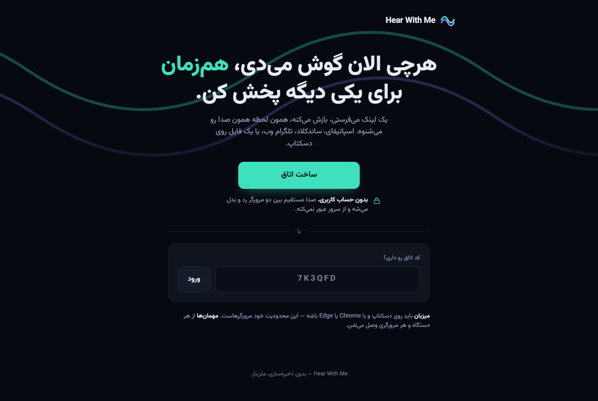
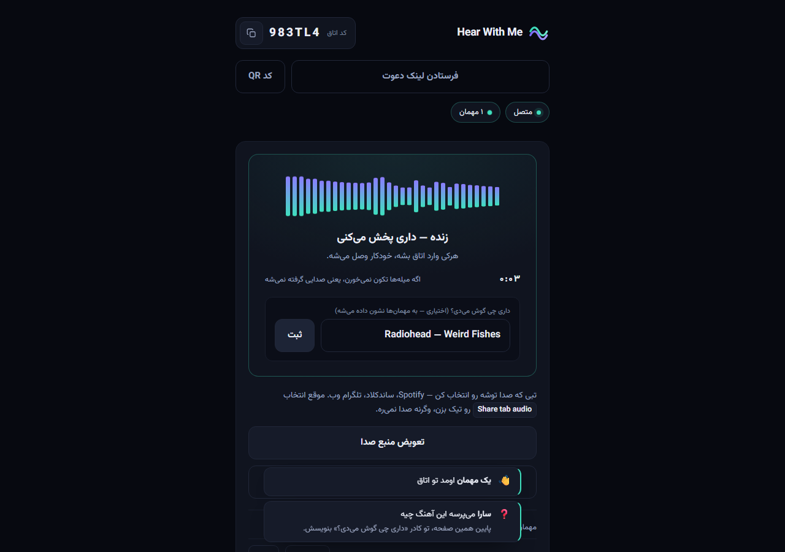
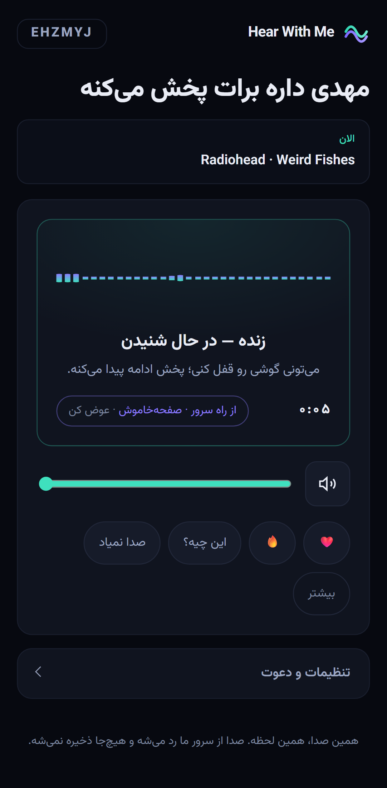

<div align="center">
  
  <h1>Hear With Me</h1>
  <p><strong>Whatever you hear, they hear too — live, from a link.</strong></p>
  <p>
    <a href="README.fa.md">فارسی</a> ·
     ·
     ·
    
  </p>
</div>



## What this is

You are listening to something on your computer — a Spotify tab, YouTube,
a local file, a native app. You send one link. The other person opens it on
their phone and hears what you hear, at the same moment — even with their
phone locked in a pocket.

**It is not a synced player and not a shared playlist.** Nobody picks a track.
The host's real audio output is captured in the browser and sent on, so
whatever comes out of their speakers comes out of yours.

Nothing is stored: no accounts, no recordings, and a room leaves nothing behind
when it closes.

<table>
<tr>
<td width="62%"></td>
<td></td>
</tr>
<tr>
<td align="center"><sub>Host — desktop</sub></td>
<td align="center"><sub>Guest — phone</sub></td>
</tr>
</table>

## Two paths for one sound

| | Direct | Screen-off |
|---|---|---|
| How | WebRTC, browser to browser | AAC through the server, into a plain `<audio>` element |
| Delay | under a tenth of a second | about two to four seconds |
| Locked phone | stops (the OS treats it as a call) | keeps playing, with lock-screen controls |
| Networks without UDP (common in Iran) | may never connect | works wherever the page loads |
| The audio passes through the server | no | yes, in memory only; never stored |

Phones start on screen-off, desktops on direct, and either can switch at any
time from the chip on the stage. A direct connection that is not up within six
seconds falls back to screen-off by itself, and says so. The host can keep a
room **direct only** from its settings.

Screen-off is AAC because every phone plays an AAC stream — iPhones included —
and a listener can start at any frame. The host's browser encodes it with
WebCodecs (desktop Chrome and Edge do), only while someone is listening that
way; where AAC is not available it falls back to WebM/Opus, which iPhones
cannot play.

## Requirements

| | |
|---|---|
| **Host, sharing what is playing** | Desktop **Chrome or Edge**. No phone browser hands out another app's or tab's sound — a browser limitation, not a missing feature. |
| **Host, from a phone** | Any phone: the host plays an audio file of their own into the room. |
| **Guest** | Any device, any browser, iPhone included. |

## Run it

```bash
node server.js
```

Then open `http://localhost:3000`. There is nothing to install: no npm
dependencies at runtime and no build step.

To try it across two real devices, the server has to be reachable over
**HTTPS** — `getDisplayMedia`, WebCodecs and `RTCPeerConnection` only work in
a secure context, and `localhost` is the single exception:

```bash
ssh -R 80:localhost:3000 nokey@localhost.run
```

> **Note:** Cloudflare quick tunnels (`trycloudflare.com`) do not work. They
> buffer the whole response body, and this server's signaling is Server-Sent
> Events, so the browser receives nothing and the room hangs on "connecting".

## What a room can do

**Host**

- Rehearse Chrome's picker before it opens — the one switch ("Share tab audio")
  that decides whether anyone hears anything — then a signal check: the room is
  called live only once sound is actually heard.
- Switch the source mid-session — `replaceTrack`, so no guest drops out.
- Play a file from this device instead; mix their own microphone in.
- Set the audio quality, lock the room, remove a guest, hand hosting over,
  end the room on leaving, keep it direct-only.
- Their name goes into the link preview: "Mehdi is playing live".
- Two columns on a desktop, with the QR code beside the stage.

**Guest**

- The page leads with who is playing, then one tap to listen, choosing between
  screen-off and direct with the cost of each said plainly.
- React: ❤️ / 🔥 / "what is this?" / "no sound", and two more behind "more".
  Anything the host must act on stays put and says what to do about it.
- Car mode: the host's name, the state, and one big button.
- When it ends: how long they listened, a link to send to their own computer,
  and a story card.

## How it works

```
Audio source (anything)           or a file on the host's device
        │
Capture                     ← host's browser: getDisplayMedia, or Web Audio for a file
        │
   ┌────┴────────────────────────────┐
WebRTC (direct)              AAC encoder (WebCodecs), only on demand
   │                                 │
   │                         Room server: framing + fan-out, in memory
   │                                 │
Guest: srcObject             Guest: <audio src>, survives a locked screen
```

The server creates rooms, decides who the host is, relays signaling, and — for
screen-off listeners only — passes the host's encoded audio on. It reaches
members over **Server-Sent Events** or a **WebSocket**: the page carries a
`transport` meta tag that the server fills in, and the client speaks both. An
edge runtime that cannot hold a response open serves the same client with `ws`.

```
server.js          wiring
lib/               config · room · rooms · routes · sse · http · rate-limit · metrics
public/app.js      client entry — roles and event routing, no logic
public/js/         host-session · guest-session · relay-encoder · relay-player · platform ·
                   dom · api · roster · notices · audio-meter · end-card · car-mode · …
public/shared/     reactions · room-code · relay-framing · preview · metrics —
                   one definition each, used by the server(s) and the page
public/sw.js       the app shell, for installing; never touches /api/
```

`public/js/platform.js` is the one place that knows what the device can do. An
app shell (Capacitor, for Android and later iPhone) would replace that seam to
let a phone capture other apps' sound natively.

## Configuration

| Variable | Default | What it does |
|---|---|---|
| `PORT` | `3000` | |
| `STUN_URL` | Google's public STUN | Comma-separated for several |
| `TURN_URL` · `TURN_USERNAME` · `TURN_PASSWORD` | — | Added to what clients receive |
| `MAX_ROOMS` | `500` | Concurrent rooms |
| `ROOMS_PER_IP` | `12` | Room creations per IP per 10 minutes |
| `API_REQUESTS_PER_MINUTE` | `900` | Every API call, per IP |
| `ROOM_LOOKUPS_PER_MINUTE` | `60` | Looking a room up by code, per IP |
| `DISCONNECT_GRACE_MS` | `10000` | How long a dropped connection keeps its place |
| `RELAY_BACKLOG_MS` | `1500` | How much audio a screen-off listener starts with |
| `STATS_TOKEN` | — | Lets `GET /api/stats?token=…` read the counters |

**Counters.** The page reports a few named events — a listen started and on
which path, a direct connection that failed and what ICE had found, a share
that was silent — and the server keeps one number per day, event and value.
No ids, names, codes or addresses; anything outside the allowlist in
`public/shared/metrics.js` is dropped.

## Tests

```bash
npm test                                              # rooms, QR, relay framing, previews, limits
npm install --no-save playwright && npx playwright install chromium
npm run test:e2e                                      # real browsers, both paths
```

`test-e2e.js` drives a real host and two guests over WebRTC. `test-relay.js`
covers the rest in real browsers: screen-off audio arriving as AAC, the
fallback when a direct connection never comes up, a phone's first tap, the
host's direct-only switch, the microphone, the end card, and a phone hosting
from a file. Point it at another deployment with `BASE=…`.

## Limits worth knowing

- **Whether a locked phone keeps playing is only proven on a phone.** The
  screen-off path is built exactly the way internet radio is, which phones do
  play in the background; desktop browsers cannot show it.
- **A phone cannot share another app's sound** from a browser. A native
  Android app could (`MediaProjection` + `AudioPlaybackCapture`); it is not
  built yet.
- **The room code is the only protection.** Locking and removing are social
  controls, not security.
- **Nothing is stored.** Restarting the server clears every room.
